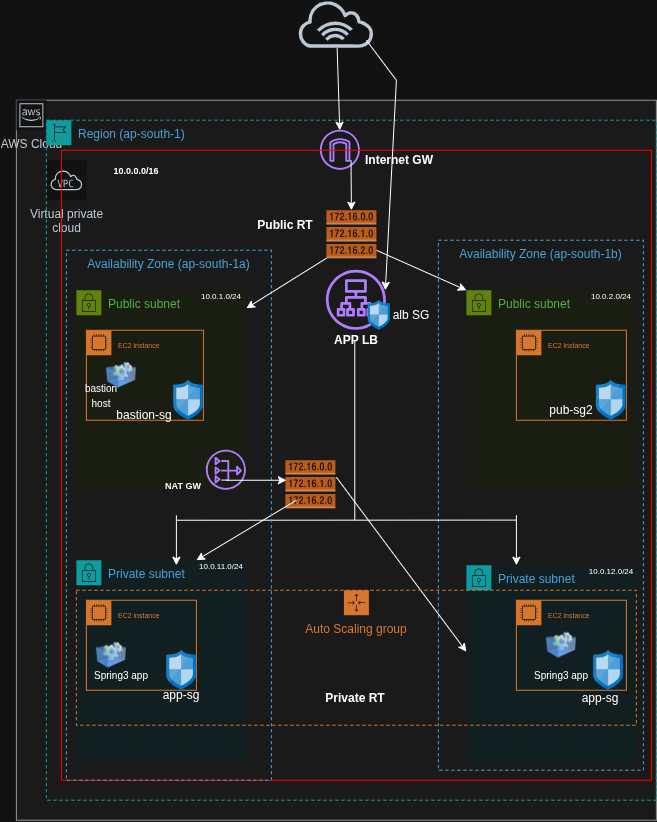
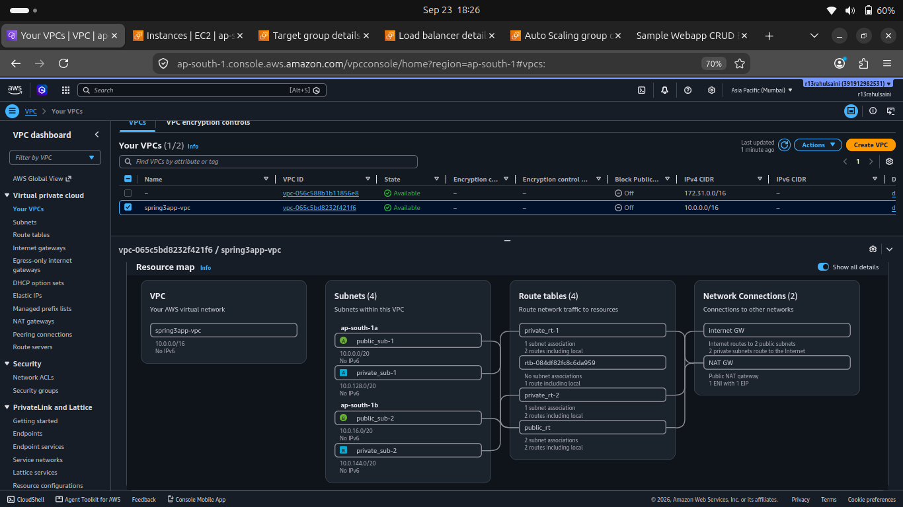
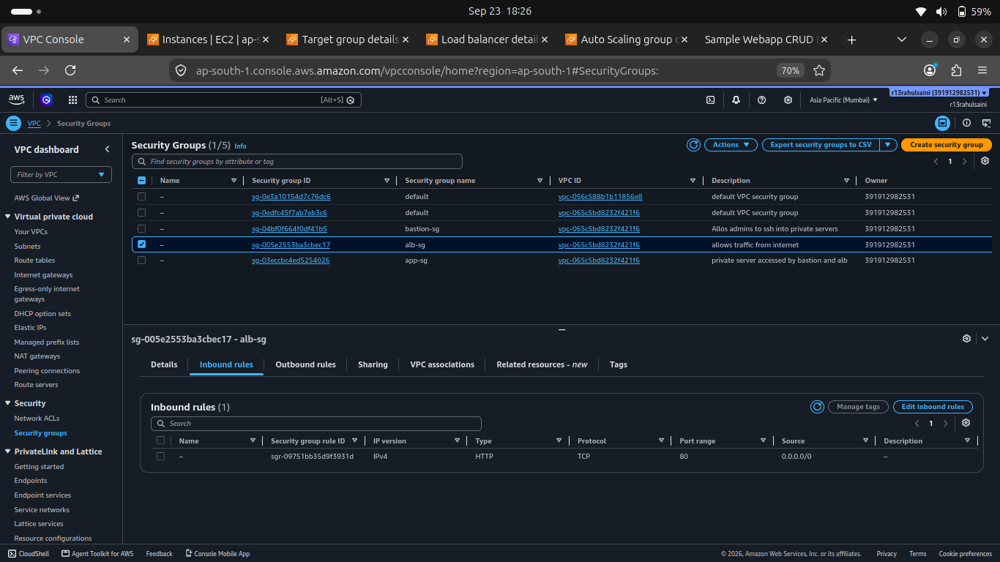
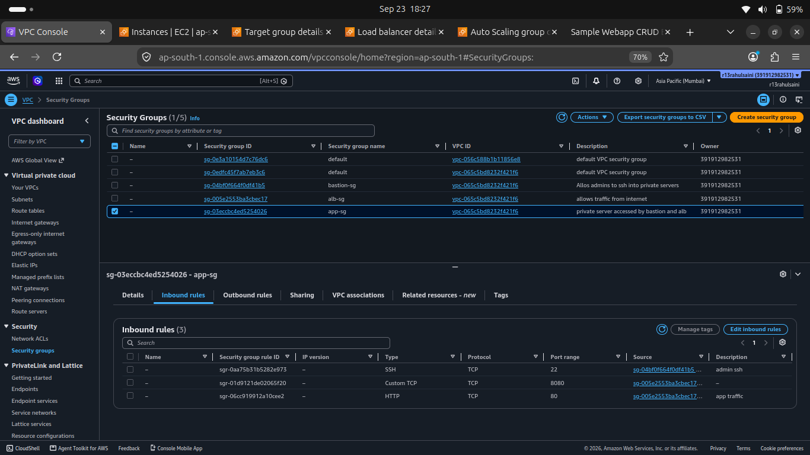

# High-Availability Deployment of Spring 3 + Hibernate App on AWS

This repository documents the end-to-end setup and deployment of a legacy **Spring 3 + Hibernate web application** (`rahul96saini/spring3hibernate`) behind an **Application Load Balancer (ALB)** and **Auto Scaling Group (ASG)** within private subnets on AWS.

---
##  System Architecture Overview

* **VPC Setup:** Custom VPC with Public and Private Subnets across multiple Availability Zones.
* **Internet Connectivity:** Outbound traffic for private instances is routed through a **NAT Gateway** residing in a public subnet.
* **Load Balancer:** Public **Application Load Balancer (ALB)** receiving HTTP traffic on Port 80.
* **Auto Scaling Group:** EC2 instances launched in **Private Subnets** running Ubuntu 24.04 LTS.
* **Security Isolation:**
  * **Bastion Host Security Group (`bastion-sg`):** Accepts SSH (Port 22) from authorized IP addresses.
  * **ALB Security Group (`alb-sg`):** Accepts HTTP (Port 80) from `0.0.0.0/0`.
  * **Application Security Group (`app-sg`):** Accepts TCP on Port 8080 restricted *only* to `alb-sg`, and SSH on Port 22 restricted *only* to `bastion-sg`.






---

##  Key Technical Challenges & Solutions

### 1. Ubuntu 24.04 & Tomcat 10 Namespace Incompatibility
* **Issue:** Running `apt install tomcat9` on Ubuntu 24.04 LTS failed or installed Tomcat 10 by default. Tomcat 10 uses `jakarta.servlet.*` packages, whereas legacy Spring 3 applications require `javax.servlet.*`.
* **Fix:** Downloaded official Apache Tomcat 9.0.85 direct tarball binaries (`apache-tomcat-9.0.85.tar.gz`) directly via `wget` and created a custom `systemd` service.

### 2. Maven Build & Static Analysis Plugin Failures
* **Issue:** Static code analysis plugins (`Checkstyle`, `FindBugs`, `PMD`, `JaCoCo`) triggered build failures during `mvn clean package`.
* **Fix:** Updated `pom.xml` to target Java 1.8 and added build flags (`-Dcheckstyle.skip=true -Dfindbugs.skip=true -Dpmd.skip=true -DskipTests`) in the deployment script to bypass non-blocking analysis checks.

### 3. ASG Health Check Race Conditions
* **Issue:** Building the application from source on startup took 3–4 minutes. The ALB health check pinged Port 8080 immediately and marked instances as `Unhealthy`, triggering a termination loop.
* **Fix:**
  * Stopped Tomcat during the Maven build phase in User Data.
  * Increased the Auto Scaling Group **Health check grace period** to `600` seconds (10 minutes).

---

##  Launch Template User Data Script

Add the following bootstrap script to your EC2 Launch Template (**Advanced Details > User Data**):

```bash
#!/bin/bash
exec > /var/log/user-data.log 2>&1
set -x

# 1. Install Java 8, Maven, Git, and Wget
sudo apt-get update -y
sudo apt-get install -y openjdk-8-jdk maven git wget

# Force Java 8 as default active compiler
sudo update-java-alternatives -s java-1.8.0-openjdk-amd64 || true

# 2. Download and extract Apache Tomcat 9
cd /tmp
wget https://archive.apache.org/dist/tomcat/tomcat-9/v9.0.85/bin/apache-tomcat-9.0.85.tar.gz
sudo tar -xzf apache-tomcat-9.0.85.tar.gz -C /opt/
sudo mv /opt/apache-tomcat-9.0.85 /opt/tomcat9

# Create system user for Tomcat
sudo useradd -r -s /bin/false tomcat || true
sudo chown -R tomcat:tomcat /opt/tomcat9

# 3. Clone application repository
rm -rf /tmp/app
git clone https://github.com/rahul96saini/spring3hibernate.git /tmp/app
cd /tmp/app

# 4. Build application binary
mvn clean package -DskipTests -Dcheckstyle.skip=true -Dfindbugs.skip=true -Dpmd.skip=true

# 5. Deploy WAR file as ROOT webapp
sudo rm -rf /opt/tomcat9/webapps/ROOT*
sudo cp target/Spring3HibernateApp.war /opt/tomcat9/webapps/ROOT.war
sudo chown -R tomcat:tomcat /opt/tomcat9/webapps/

# 6. Configure systemd service
cat << 'EOF' | sudo tee /etc/systemd/system/tomcat9.service
[Unit]
Description=Apache Tomcat 9 Web Application Server
After=network.target

[Service]
Type=forking

User=tomcat
Group=tomcat

Environment="JAVA_HOME=/usr/lib/jvm/java-8-openjdk-amd64"
Environment="CATALINA_PID=/opt/tomcat9/temp/tomcat.pid"
Environment="CATALINA_HOME=/opt/tomcat9"
Environment="CATALINA_BASE=/opt/tomcat9"

ExecStart=/opt/tomcat9/bin/startup.sh
ExecStop=/opt/tomcat9/bin/shutdown.sh

[Install]
WantedBy=multi-user.target
EOF

# 7. Enable and start Tomcat
sudo systemctl daemon-reload
sudo systemctl enable tomcat9
sudo systemctl start tomcat9
```

---

##  Deployment & Verification Steps

1. **Target Group Settings:**
   * **Protocol / Port:** HTTP / 8080
   * **Health Check Path:** `/`
   * **Success Codes:** `200`
2. **Auto Scaling Group Configuration:**
   * Assign private subnets.
   * Attach target group `spring3app-TG-new`.
   * Set **Health check grace period** to `600` seconds.
3. **Verification:**
   * Monitor **Target Groups > Targets** until instances report status **`Healthy`**.
   * Access the public DNS URL provided by the ALB:
     ```
     http://<your-alb-dns-name>.elb.amazonaws.com
     ```
---