# Assignment 04 - Terraform IaC: Redis High Availability

## Table of Contents
1. Assignment Overview
2. Objective
3. Technology Stack
4. Architecture
5. Infrastructure Components
6. Redis High Availability
7. Terraform Project Structure
8. Network Configuration
9. Security Groups
10. Terraform Configuration
11. Terraform Deployment
12. Redis and Sentinel Configuration
13. Verification
14. Terraform Remote State with S3
15. Destroying the Infrastructure
16. Final Result

## Assignment Overview

This assignment was completed using **Terraform Infrastructure as Code (IaC)** with **Redis** as the individual tool.

The objective was to design an AWS infrastructure architecture, provision it using Terraform, configure Redis with high availability using Redis Sentinel, verify the deployment, store Terraform state remotely in Amazon S3, and finally destroy the infrastructure after completing the assignment.

## Objective

- Design an AWS infrastructure diagram.
- Provision the infrastructure completely using Terraform.
- Create a VPC with public and private subnets.
- Deploy Redis on Ubuntu EC2 instances.
- Configure Redis Primary and Replica.
- Configure Redis Sentinel for high availability.
- Use a Bastion host to access private instances.
- Configure NAT Gateway for private subnet outbound connectivity.
- Configure Security Groups.
- Store Terraform state remotely in Amazon S3.
- Verify Redis and Sentinel services.
- Destroy the AWS infrastructure after completion.

## Technology Stack

| Technology | Purpose |
|---|---|
| AWS VPC | Network isolation |
| Amazon EC2 | Redis, Sentinel and Bastion servers |
| Amazon S3 | Terraform remote state |
| Internet Gateway | Internet connectivity for public subnet |
| NAT Gateway | Outbound internet access for private subnets |
| Security Groups | Network access control |
| Terraform | Infrastructure as Code |
| Ubuntu | Operating system |
| Redis | In-memory data store |
| Redis Sentinel | Redis high availability and automatic failover |

## Architecture

The final architecture used:

- 1 VPC
- 1 Public Subnet
- 3 Private Subnets
- 1 Internet Gateway
- 1 NAT Gateway
- 1 Bastion Host
- 1 Redis Primary
- 1 Redis Replica
- 3 Redis Sentinel processes
- Security Groups
- Amazon S3 for Terraform state

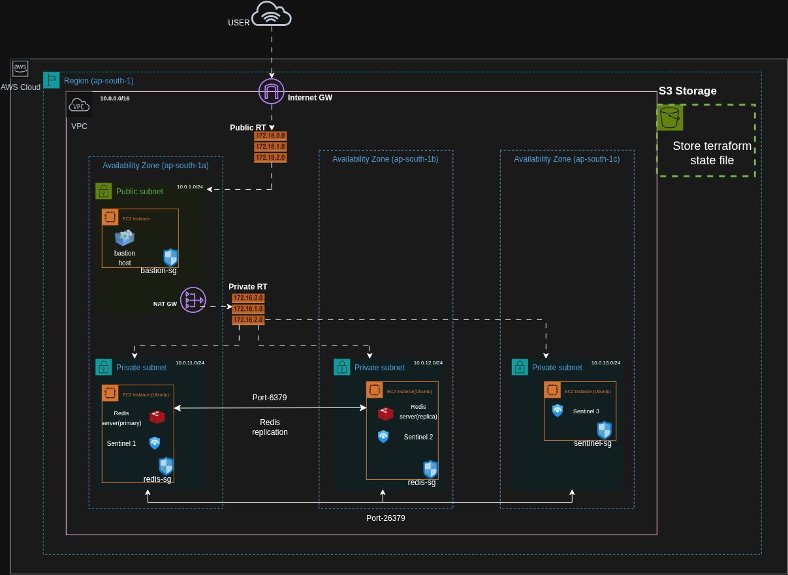

### Redis High Availability Design

```text
AWS Region: ap-south-1
|
+-- VPC: 10.0.0.0/16
    |
    +-- Public Subnet: 10.0.1.0/24
    |   |
    |   +-- Bastion Host
    |   +-- NAT Gateway
    |
    +-- Private Subnet 1: 10.0.11.0/24
    |   |
    |   +-- Redis Primary
    |   +-- Sentinel 1
    |
    +-- Private Subnet 2: 10.0.12.0/24
    |   |
    |   +-- Redis Replica
    |   +-- Sentinel 2
    |
    +-- Private Subnet 3: 10.0.13.0/24
        |
        +-- Sentinel 3
```

### Sentinel Communication

```text
Redis:     TCP 6379
Sentinel:  TCP 26379
```

Three Sentinel processes were used so that Sentinel quorum could be achieved.

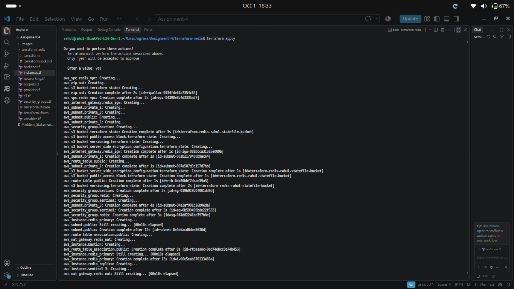
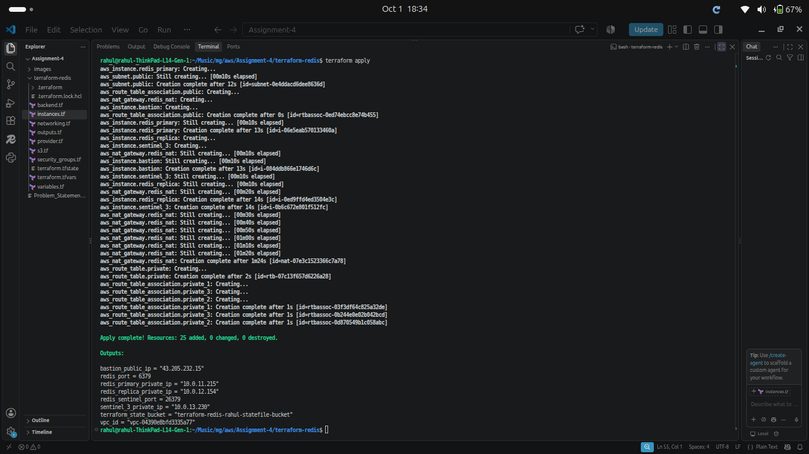
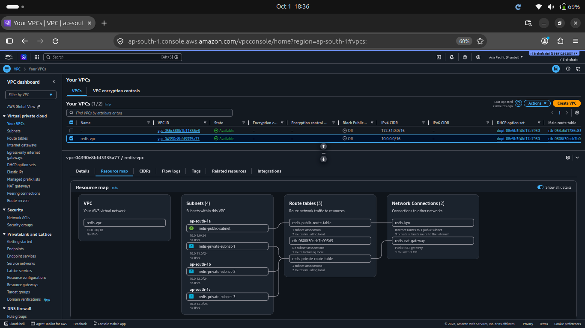
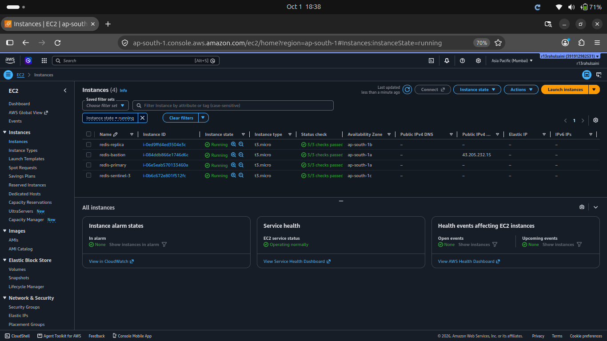

## Infrastructure Components

### VPC

```text
10.0.0.0/16
```

### Public Subnet

```text
10.0.1.0/24
```

Availability Zone:

```text
ap-south-1a
```

Contains the Bastion Host and NAT Gateway.

### Private Subnets

```text
10.0.11.0/24  -> ap-south-1a
10.0.12.0/24  -> ap-south-1b
10.0.13.0/24  -> ap-south-1c
```

### Bastion Host

The Bastion Host was placed in the public subnet and was used to provide SSH access to Redis and Sentinel servers in the private subnets.


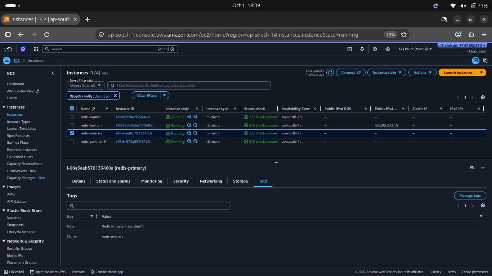


### NAT Gateway

The NAT Gateway was placed in the public subnet. Private subnet instances used it for outbound internet access, such as downloading the Redis package during EC2 initialization.

## Redis High Availability

The Redis setup consisted of:

```text
Redis Primary
      |
      | Replication
      v
Redis Replica
```

Redis Sentinel monitored the Redis Primary:

```text
              Sentinel 1
                  |
                  |
Sentinel 2 ---- Redis Primary ---- Redis Replica
                  |
                  |
              Sentinel 3
```

Configuration:

```text
Quorum: 2
Sentinel Port: 26379
Redis Port: 6379
```

Sentinel was configured to monitor the Redis Primary and perform failover when the Primary becomes unavailable.

## Terraform Project Structure

```text
terraform-redis/
|
+-- provider.tf
+-- networking.tf
+-- security_groups.tf
+-- instances.tf
+-- s3.tf
+-- variables.tf
+-- terraform.tfvars
+-- outputs.tf
+-- backend.tf
```

### provider.tf

Contains the Terraform and AWS provider configuration.

AWS provider version:

```text
6.66.0
```

AWS Region:

```text
ap-south-1
```

### networking.tf

Contains:

- VPC
- Subnets
- Internet Gateway
- Route Tables
- Route Table Associations
- Elastic IP
- NAT Gateway

### security_groups.tf

Contains Security Groups for Bastion, Redis and Sentinel.

### instances.tf

Contains:

- Bastion EC2
- Redis Primary + Sentinel 1
- Redis Replica + Sentinel 2
- Sentinel 3

### s3.tf

Contains the Amazon S3 bucket used for Terraform state.

### variables.tf

Contains configurable values such as VPC CIDR, subnet CIDRs, instance type, key pair, public IP, Redis password and S3 bucket name.

### terraform.tfvars

Contains the values used for the assignment.

### outputs.tf

Contains useful outputs such as VPC ID, Bastion public IP, Redis private IPs, Sentinel private IP, ports and S3 bucket name.

### backend.tf

The S3 remote backend was configured as:

```hcl
terraform {
  backend "s3" {
    bucket = "terraform-redis-rahul-statefile-bucket"
    key    = "redis/terraform.tfstate"
    region = "ap-south-1"
  }
}
```

## Network Configuration

### VPC

```text
10.0.0.0/16
```

### Subnets

| Subnet | CIDR | Availability Zone | Type |
|---|---|---|---|
| Public | 10.0.1.0/24 | ap-south-1a | Public |
| Private 1 | 10.0.11.0/24 | ap-south-1a | Private |
| Private 2 | 10.0.12.0/24 | ap-south-1b | Private |
| Private 3 | 10.0.13.0/24 | ap-south-1c | Private |

### Routing

Public subnet:

```text
0.0.0.0/0 -> Internet Gateway
```

Private subnets:

```text
0.0.0.0/0 -> NAT Gateway
```

## Security Groups

### Bastion Security Group

```text
Port: 22
Protocol: TCP
Source: Configured public IP
```

### Redis Security Group

```text
22    -> SSH from Bastion
6379  -> Redis traffic inside VPC
26379 -> Sentinel traffic inside VPC
```

### Sentinel Security Group

```text
22    -> SSH from Bastion
6379  -> Redis communication
26379 -> Sentinel communication
```

## Terraform Deployment

The Terraform workflow used was:

```bash
terraform init
terraform fmt
terraform validate
terraform plan
terraform apply
```

### terraform init

Initializes the Terraform working directory and downloads the required provider.

### terraform fmt

Formats Terraform configuration files.

### terraform validate

Checks whether the Terraform configuration is valid.

### terraform plan

Shows the resources Terraform will create, modify or destroy.

### terraform apply

Creates or modifies the AWS infrastructure.

## Redis and Sentinel Configuration

### Redis Primary

The Primary server was configured with:

```text
Redis Port: 6379
Password Authentication: Enabled
Protected Mode: Enabled
Bind: 0.0.0.0
```

Sentinel 1 was installed on the same EC2 instance.

### Redis Replica

The Replica was configured with:

```text
Redis Port: 6379
Master Authentication: Enabled
Replica Of: Redis Primary
```

Sentinel 2 was installed on the same EC2 instance.

### Sentinel 3

A separate EC2 instance was used for the third Sentinel.

This provided three Sentinel processes across three Availability Zones.

## Verification

### Check Redis

```bash
sudo systemctl status redis-server
```

### Check Sentinel

```bash
sudo systemctl status redis-sentinel
```

### Test Redis

```bash
redis-cli -a 123 ping
```

Expected:

```text
PONG
```

### Test Sentinel

```bash
redis-cli -p 26379 ping
```

Expected:

```text
PONG
```

### Check Sentinel Master

```bash
redis-cli -p 26379 SENTINEL master mymaster
```

### Check Redis Replicas

```bash
redis-cli -p 26379 SENTINEL replicas mymaster
```

These checks confirmed that Redis and Sentinel were running.

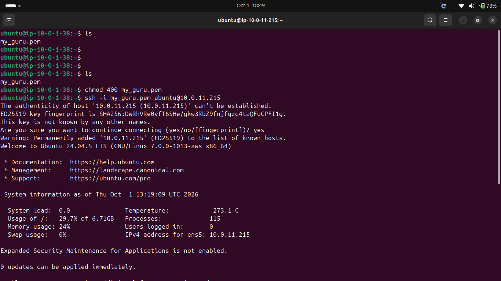
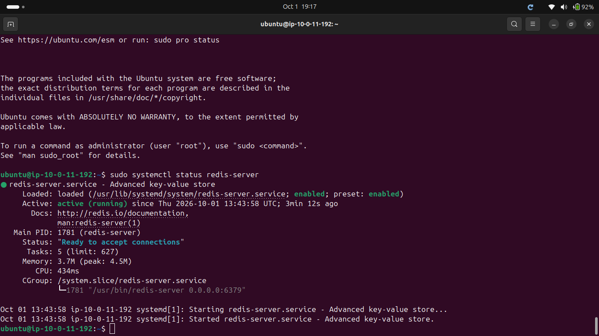
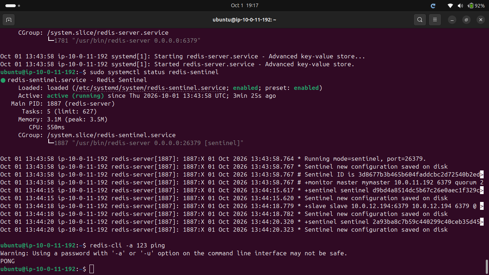
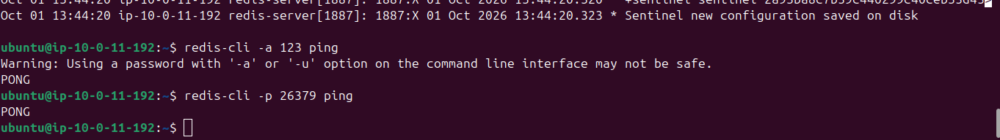
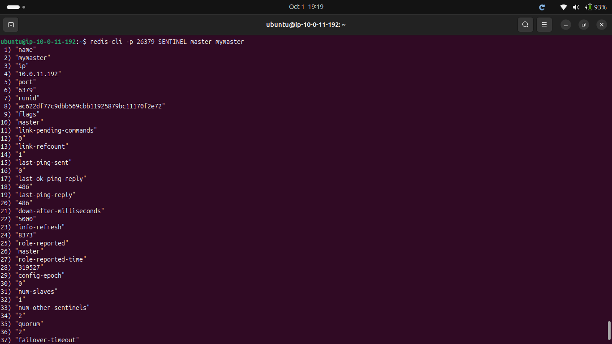
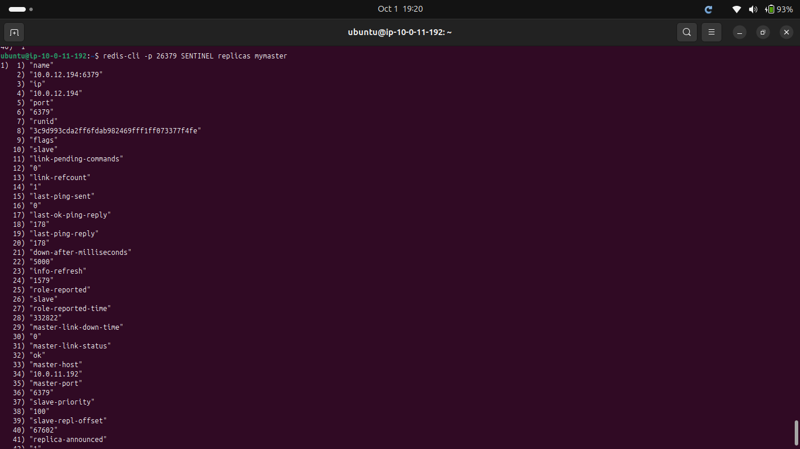

## Terraform Remote State with S3

Terraform state was initially created locally so that the S3 bucket could be created.

After the S3 bucket was created, the S3 backend was configured and the state was migrated using:

```bash
terraform init -migrate-state
```

The S3 bucket used:

- Versioning
- Server-side encryption
- Public access blocking

The state was stored at:

```text
s3://terraform-redis-rahul-statefile-bucket/redis/terraform.tfstate
```

## Destroying the Infrastructure

After completing and verifying the assignment, the AWS infrastructure was destroyed using:

```bash
terraform destroy
```

The S3 bucket initially could not be deleted because versioned state objects were still present.

After the assignment was completed, the versioned objects were removed and the S3 bucket was successfully deleted.

All AWS resources created for the assignment were ultimately cleaned up.

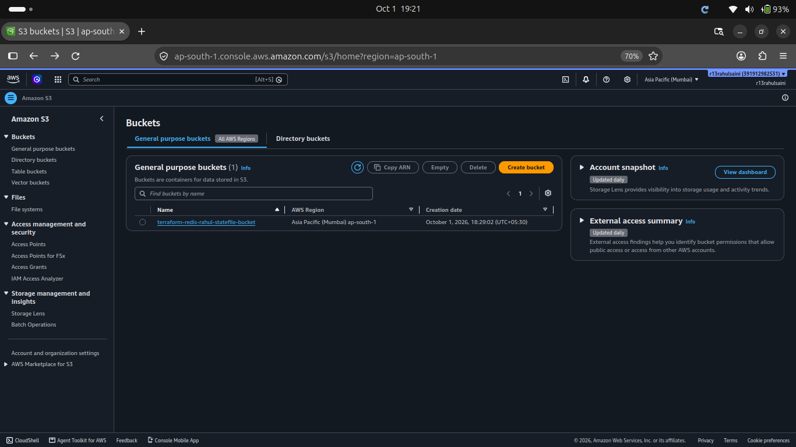
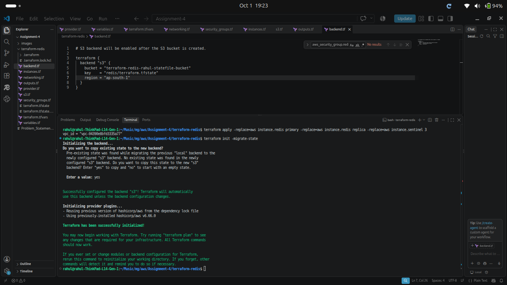
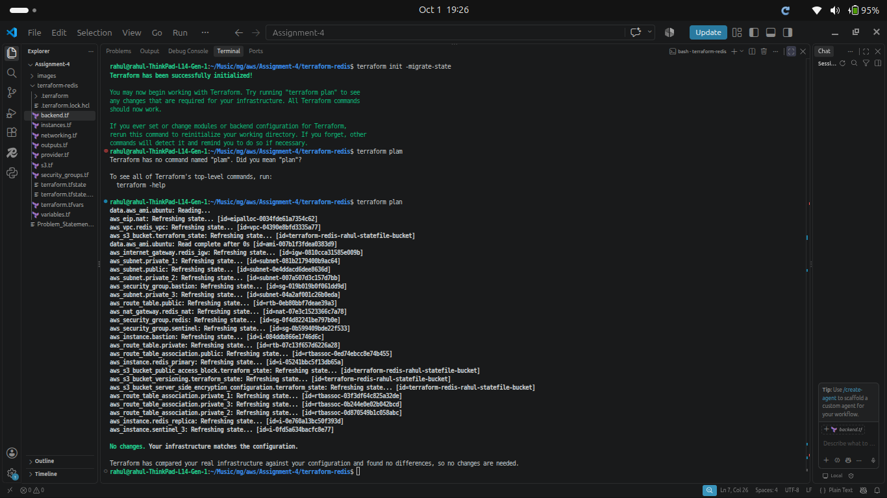
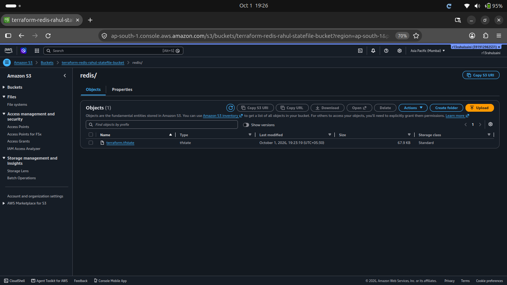
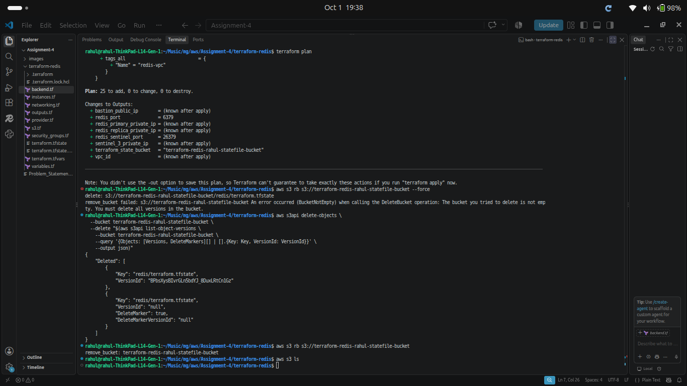

## Final Result

The assignment was successfully completed using Terraform.

The implementation included:

- AWS VPC networking
- Public and private subnets
- Bastion Host
- NAT Gateway
- Redis Primary
- Redis Replica
- Redis Sentinel 1
- Redis Sentinel 2
- Redis Sentinel 3
- Security Groups
- Terraform remote state using S3
- Redis and Sentinel verification
- Complete infrastructure cleanup

## Conclusion

This assignment provided practical experience with:

- Terraform Infrastructure as Code
- AWS networking
- VPC and subnet design
- Public and private infrastructure
- EC2 provisioning
- NAT Gateway
- Security Groups
- Redis replication
- Redis Sentinel high availability
- Terraform remote state
- Amazon S3
- Infrastructure lifecycle management

The complete infrastructure was provisioned and managed through Terraform, verified successfully, and then completely destroyed after the assignment was completed.
