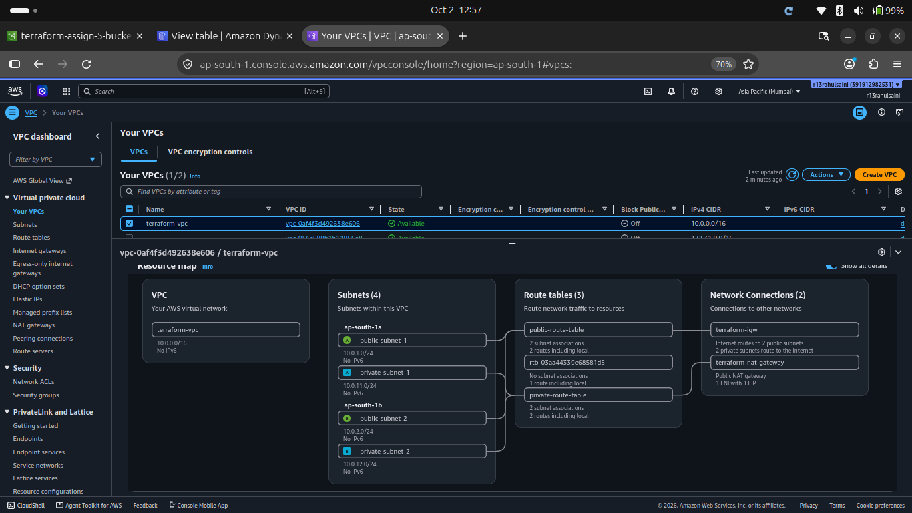
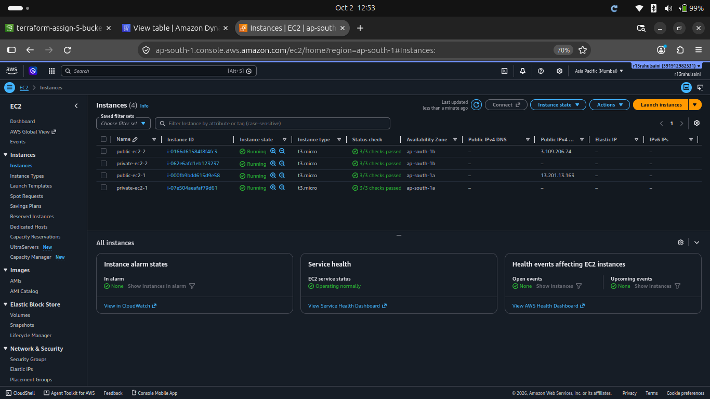
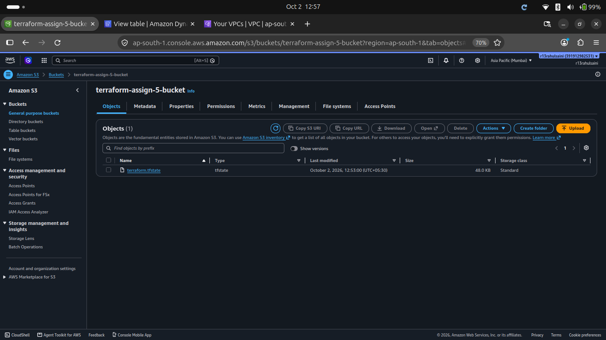
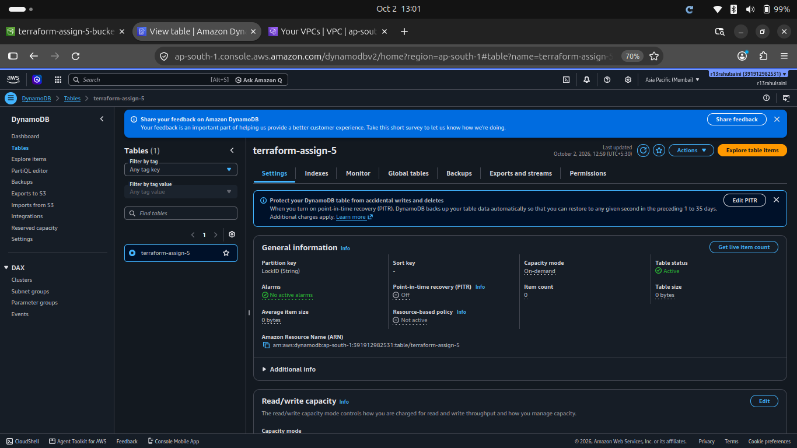
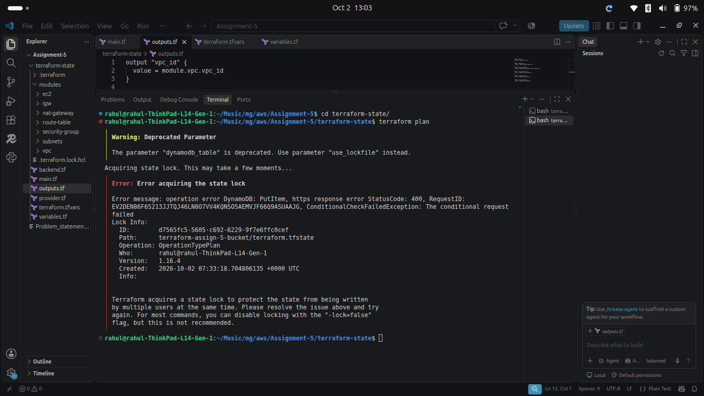
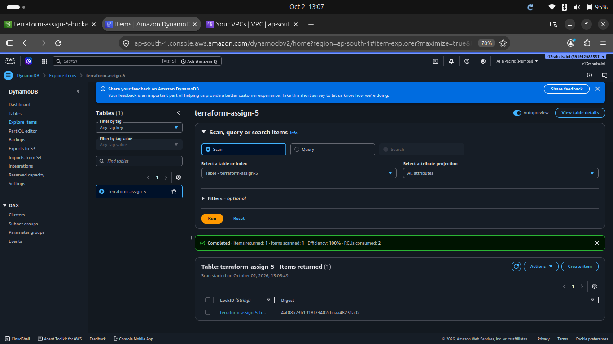
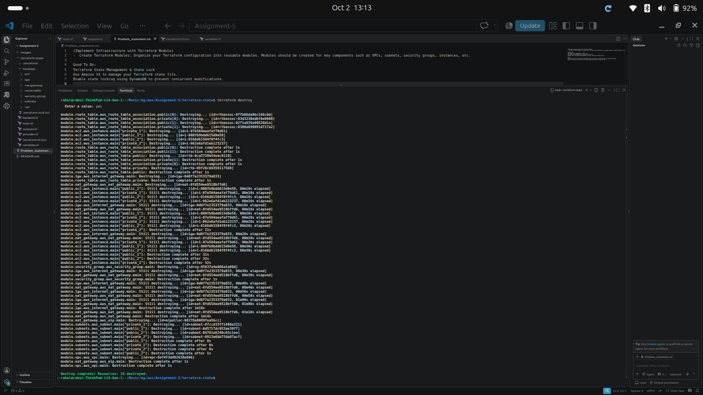

# Terraform Infrastructure Assignment

## 1. Assignment Overview

This project implements AWS infrastructure using **Terraform modules**.

The infrastructure includes:

- 1 VPC
- 2 Availability Zones
- 2 Public Subnets
- 2 Private Subnets
- 1 Internet Gateway
- 1 NAT Gateway
- Public and Private Route Tables
- Route Table Associations
- 1 Security Group
- 4 EC2 Instances
- Amazon S3 for Terraform remote state
- Amazon DynamoDB for Terraform state locking

The infrastructure is divided into reusable Terraform modules.

---

## 2. Architecture

```text
                         Internet
                            |
                     Internet Gateway
                            |
                 -----------------------
                 |                     |
              Public AZ-1           Public AZ-2
              10.0.1.0/24           10.0.2.0/24
                 |                     |
              EC2-1                 EC2-2
                 |
             NAT Gateway
                 |
                 -----------------------
                 |                     |
             Private AZ-1          Private AZ-2
             10.0.11.0/24          10.0.12.0/24
                 |                     |
              EC2-3                 EC2-4
```

### Terraform State

```text
Terraform
    |
    +---- S3 Bucket
    |       |
    |       +---- terraform.tfstate
    |
    +---- DynamoDB
            |
            +---- State Lock
```

---

## 3. Network Configuration

### VPC

| Resource | CIDR |
|---|---|
| VPC | 10.0.0.0/16 |

### Subnets

| Subnet | CIDR | Availability Zone | Type |
|---|---|---|---|
| Public Subnet 1 | 10.0.1.0/24 | ap-south-1a | Public |
| Public Subnet 2 | 10.0.2.0/24 | ap-south-1b | Public |
| Private Subnet 1 | 10.0.11.0/24 | ap-south-1a | Private |
| Private Subnet 2 | 10.0.12.0/24 | ap-south-1b | Private |

Public subnets automatically assign public IP addresses to launched EC2 instances.

Private subnets do not automatically assign public IP addresses.

---

## 4. Routing

### Public Route Table

The public route table contains:

```text
0.0.0.0/0 -> Internet Gateway
```

It is associated with both public subnets.

### Private Route Table

The private route table contains:

```text
0.0.0.0/0 -> NAT Gateway
```

It is associated with both private subnets.

The NAT Gateway is placed in the first public subnet.

---

## 5. Security Group

A single security group is used for the EC2 instances.

### Inbound

| Protocol | Port | Source |
|---|---:|---|
| TCP | 22 | 0.0.0.0/0 |

### Outbound

All outbound traffic is allowed.

---



## 6. EC2 Instances

Four EC2 instances are created using Terraform `for_each`.

| Instance | Subnet |
|---|---|
| public-ec2-1 | Public Subnet 1 |
| public-ec2-2 | Public Subnet 2 |
| private-ec2-1 | Private Subnet 1 |
| private-ec2-2 | Private Subnet 2 |

Configuration:

- AMI: `ami-006f82a1d5a27da54`
- Instance type: `t3.micro`
- Key pair: `my_guru`
- Region: `ap-south-1`

---



## 7. Terraform Module Structure

```text
terraform-state/
├── backend.tf
├── provider.tf
├── main.tf
├── variables.tf
├── outputs.tf
├── terraform.tfvars
├── terraform.lock.hcl
│
└── modules/
    ├── vpc/
    │   ├── main.tf
    │   ├── variables.tf
    │   └── outputs.tf
    │
    ├── subnets/
    │   ├── main.tf
    │   ├── variables.tf
    │   └── outputs.tf
    │
    ├── igw/
    │   ├── main.tf
    │   ├── variables.tf
    │   └── outputs.tf
    │
    ├── nat-gateway/
    │   ├── main.tf
    │   ├── variables.tf
    │   └── outputs.tf
    │
    ├── route-table/
    │   ├── main.tf
    │   ├── variables.tf
    │   └── outputs.tf
    │
    ├── security-group/
    │   ├── main.tf
    │   ├── variables.tf
    │   └── outputs.tf
    │
    └── ec2/
        ├── main.tf
        ├── variables.tf
        └── outputs.tf
```

---

## 8. Terraform Concepts Used

### Modules

Separate modules are used for:

- VPC
- Subnets
- Internet Gateway
- NAT Gateway
- Route Tables
- Security Group
- EC2

### `for_each`

`for_each` is used to create:

- Multiple subnets
- Multiple EC2 instances

### `count`

`count` is used for:

- Public route table associations
- Private route table associations

### `depends_on`

`depends_on` is used for the NAT Gateway and its Elastic IP dependency.

---

## 9. Remote State

Terraform state is stored remotely in an **Amazon S3 bucket**.

Backend configuration uses:

```hcl
terraform {
  backend "s3" {
    bucket         = "YOUR-S3-BUCKET-NAME"
    key            = "terraform.tfstate"
    region         = "ap-south-1"
    dynamodb_table = "terraform-state-lock"
    encrypt        = true
  }
}
```

The S3 bucket and DynamoDB table were created separately as backend bootstrap resources before initializing the Terraform project.

---



## 10. DynamoDB State Locking

The DynamoDB table used for state locking is:

```text
terraform-state-lock
```

State locking was successfully verified by running `terraform plan` from two terminals at the same time.

The second Terraform process returned:

```text
Error acquiring the state lock
ConditionalCheckFailedException
```

This confirms that Terraform prevented two processes from using the same state simultaneously.

---





## 11. Terraform Commands Used

Initialize Terraform:

```bash
terraform init
```

Format Terraform files:

```bash
terraform fmt
```

Validate configuration:

```bash
terraform validate
```

Create an execution plan:

```bash
terraform plan
```

Create infrastructure:

```bash
terraform apply
```

View outputs:

```bash
terraform output
```

Destroy infrastructure:

```bash
terraform destroy
```

---



## 12. Verification

The following were verified after deployment:

- Terraform configuration passed `terraform validate`.
- Terraform plan showed the expected infrastructure.
- AWS infrastructure was successfully created.
- S3 remote state was configured.
- DynamoDB state locking was successfully tested.
- Running two Terraform operations simultaneously caused the second operation to fail with a state-lock error.

---

## 13. Important Notes

- The infrastructure was created in the `ap-south-1` AWS region.
- Private EC2 instances do not receive public IP addresses.
- The NAT Gateway provides outbound internet access for private subnets.
- The DynamoDB table is used specifically for Terraform state locking.
- The S3 bucket stores the Terraform remote state.
- Run `terraform destroy` when the infrastructure is no longer required to avoid unnecessary AWS charges.

---

## 14. Conclusion

This assignment demonstrates how to build AWS infrastructure using reusable Terraform modules while using Amazon S3 for remote Terraform state and DynamoDB for state locking.

The infrastructure was successfully created, tested, and the DynamoDB state-locking mechanism was verified.
